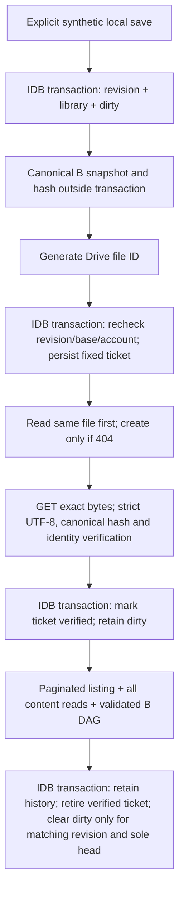

# SYNC-002C — Isolated IndexedDB / Snapshot / Drive Integration

Status: **isolated integration PoC validated with real Google Drive**, based on the owner-operated evidence recorded below. Production synchronization remains **NO-GO**. Actual iOS Safari/installed-PWA acceptance and the other open gates remain outstanding. No production application, migration, timer, service worker, hosting or OAuth configuration was changed.

## Local Git baseline

Owner authorized exactly two local commits on `docs/close-data-001`:

1. `6ea6d3480de9d170c03cb7ab0ed1cb841c6dc084` — documentation housekeeping (backlog, INFO brief, handoff README).
2. `0f09162c9be994064ef53ee6d1bd0e2ee9f36ff5` — reviewed SYNC-001/002A/002B specifications, reports, tools and tests.

Annotated tag `checkpoint/before-sync-002c` resolves to commit `0f09162c9be994064ef53ee6d1bd0e2ee9f36ff5`. Dedicated branch: `feature/sync-002c-isolated-integration`. Local `main` and the existing `origin/main` ref remain `409229ae428d9cdea41306a91a2a47984a857ec2`; main is the ancestor of the documentation baseline. Remote refs were inspected locally, not fetched or pushed in this increment. Existing rollback tags were preserved. Historic handoff documents were checkpointed unchanged, including their then-current proposed statuses. Two trailing-space findings in supplied documents are intentional Markdown line breaks.

All integration changes after the checkpoint remain uncommitted. No further commit, merge, push or deployment was performed.

Git status at implementation handoff, before this documentation-only closure (12 new files and two modified test-only modules; nothing staged):

```text
## feature/sync-002c-isolated-integration
 M tools/local-store-poc/adapter.mjs
 M tools/sync-poc/core.mjs
?? docs/SYNC-002C_ISOLATED_INTEGRATION.md
?? tools/sync-integration/
```

The new integration directory contains the eleven files enumerated below. `git diff checkpoint/before-sync-002c -- src tests .github` is empty. The branch remains at the checkpoint commit; `main` and `origin/main` are unchanged. No generated screenshots, browser profiles, secrets or populated recovery tickets are included.

## Reused components and changes

- `tools/local-store-poc/adapter.mjs`: opt-in integration configuration reuses A's strict IndexedDB transactions, revision checks, close/version-change behavior and fault injection. The default A experiment retains its original ticket format. Integration uses B ticket validation, a supplied synthetic library UUID, clean/dirty metadata and a synchronous atomic-update seam over the same four stores. No hashing/network awaits inside transactions.
- `tools/sync-core/*`: unchanged B canonical bytes, full snapshot hash, strict schema, DAG and conflict analysis. No duplicate hashing or merge algorithm.
- `tools/sync-poc/core.mjs`: opt-in, generation-bound transport capability, full account-key digest, raw-byte GET and injectable timeout. Token stays only in the existing closure; C cannot PATCH or DELETE. Old SYNC-001 UI/experiments remain separate.
- New `tools/sync-integration/`: `store.mjs`, `coordinator.mjs`, `transport.mjs`, `server.mjs`, `index.html`, `style.css`, `ui.mjs`, `fake-drive.mjs`, `transport.test.mjs`, `experiments.mjs`, `browser-check.mjs`.
- This report is the only new documentation file for C. No `src/`, existing `tests/`, PWA or workflow changes.

The subsequent owner-acceptance closure updates this report plus the existing `docs/backlog.md` and `docs/BRIEFING.md` status references only. It preserves all uncommitted implementation work and adds no code or test changes.

## Storage and flow

The synthetic experiment UUID is also the logical library UUID; independent clients share it explicitly. A local client slot selects an independent database, named `easyTimer-SYNC-002A-test-C-<uuid>-<slot>`. Merely entering another UUID does not switch stores: Open is explicit. Never reuse a real application database or copy real data into this harness.



Stores are A's `library`, `metadata`, `outbox` and `bindings`. The bindings record contains the SHA-256 digest of Drive `user.permissionId`, experiment UUID, retained validated history, known file-to-snapshot identities, local base, last complete publication ticket and the last checked heads. It contains no token, email or client secret. The digest is pseudonymous account metadata, not encryption or proof of authorization.

The immutable ticket contains exactly `operationId`, `fileId`, `libraryId`, `localRevision`, `parents`, `snapshotBytes`, `snapshotHash`, `accountKey`. Its bytes are B's complete canonical envelope including `snapshotId`; local revision, account digest and Drive ID remain outside the logical hash. No unknown fields are allowed. The ticket is committed before POST and preserved through uncertain outcomes and later edits. Disconnection/reload does not replace it. An unused generated ID after a pre-ticket revision conflict is harmless; no publication occurred.

Publication checks the exact fixed file first. A verified file avoids another POST. Otherwise only a 404 permits create with that fixed ID. Success, 409 or an ambiguous network/abort outcome is followed by exact-file readback; unresolved readback leaves the ticket pending. An explicit **Repeat verified create (409 probe)** action first verifies the existing file, then repeats the identical create to collect a real duplicate response when owner-operated. It never overwrites. The **simulate lost acknowledgement** action deliberately stops after the create attempt; it is not a claim of a real packet-loss experiment.

Readback checks app-data space, C's synthetic purpose/run/name/operation markers, matching metadata hash, strict fatal UTF-8 decoding, canonical bytes and B's full content hash. Upload verification changes only outbox stage. A later complete discovery must include the exact file before the ticket can be retired. A newer local revision remains dirty, even when the old upload is valid. The last publication ticket is retained for evidence/recovery. Local edits after clean confirmation atomically make the next revision dirty again.

Listing requests only `drive.appdata`, C's distinct purpose marker and experiment UUID. All pages are required; repeated page tokens, incompleteSearch, foreign files, contradictory duplicates and more than 200 files fail visibly. Every listed file is read and validated; B validates the complete known DAG. Identical duplicate file observations are deduplicated. Missing ancestors or any previously known file/node block the update; missing listing entries never become deletion instructions. The local history cache is updated atomically with status and is never silently pruned.

Statuses deliberately differ:

- Prepared: durable work, not confirmed remotely.
- Upload verified: exact file contents read back; dirty still retained.
- Pending: local changes remain.
- Last checked: the known sole head equals the local base and the corresponding local revision is confirmed.
- Remote review required: a new sole head differs from the local base. No silent adoption.
- Remote library available / empty: no local library has been adopted or saved; no synchronized-local claim.
- Conflict: divergent known heads. No automatic merge, deletion or resolution UI.

Drive listing is not an atomic global snapshot. “Last checked” cannot rule out unpublished/offline or just-created late branches. Re-list explicitly. Later discovery preserves and reports late heads.

## First-sync and unsupported cases

- Local synthetic library + empty remote: explicit Prepare then Publish.
- Empty local + sole validated remote head: explicit Adopt, preserving stable IDs, ready for local test edits. Never adopted into a nonempty local library.
- Both nonempty without a shared base: blocked; no implicit union or overwrite.
- Different Google account: binding fails even without an outbox. Reconnect the original account or use a distinct empty synthetic experiment/client slot; no automatic rebinding.
- Two heads: B's existing analysis is available; the integration does not publish reconciliation snapshots or choose conflict outcomes.
- More than two heads, missing/invalid history, unrelated roots, ambiguous common ancestors, unsupported ordering policy and restoration requiring review remain blocked. Existing B tests cover semantic merge validation independently.
- Intentional local deletion produces explicit tombstones in the next snapshot. Restoring a tombstoned ID is blocked pending explicit review. Remote files are never deleted.
- No legacy PoC snapshot-format conversion, production migration, timer state, background synchronization, cleanup/GC, cross-provider or cross-account transfer.
- No promise of durable survival after browser-origin eviction, physical power loss or a user clearing site data. DATA-001 remains the separate production backup mechanism, unchanged.

## Run locally

From the repository root:

```powershell
node tools/sync-integration/server.mjs
```

Open **http://localhost:8000/** in a normal manually operated browser. The test OAuth client authorizes exactly this origin. `127.0.0.1` and another port are not equivalent authorized OAuth origins. The server is loopback-only, allowlisted and serves no production app routes. If port 8000 is occupied, inspect and stop only the identified old local PoC server with owner authorization; do not kill an unknown process. Nothing was stopped or started persistently by this increment.

Prefer a fresh test profile to avoid old localhost service workers; do not clear an ordinary profile's real data. Do not copy real Rundowns or log OAuth responses. The UI shows only a summary and sanitized HTTP method/status/resource evidence, never full tickets or tokens. Recovery data stays in the test IndexedDB. Manually retain the experiment UUID and client slot outside Git. Reload requires explicitly reopening that same store and authorizing the same account.

1. Confirm disposable data, generate one UUID, choose slot A and Open.
2. Save the synthetic library. Inspect revision 1 / dirty / no ticket.
3. Load GIS explicitly, then Authorize. Denial or popup closure must leave local data usable. No Google request is made on ordinary page startup.
4. Discover: empty history for a new UUID. Prepare: durable complete ticket, no upload yet.
5. Publish. Expect sanitized create/read HTTP evidence and outbox `verified`, still dirty.
6. Before discovering, run Repeat verified create: capture actual HTTP status (expected candidate: 409) and verify the original file again. Do not label it PASS until the API response is observed.
7. Discover again: one head, retired outbox, clean matching revision, retained publication receipt.
8. Save another synthetic edit to test clean-to-dirty transition.

## Owner-operated two-context and recovery plan

Use two independent browser contexts, each manually authorized to the **same test Google account** to observe the same appData space. The successful owner test used normal Firefox and a separate private Firefox context on the same device, not a physical second device. Private-context storage may be discarded when that context closes; it is not evidence of persistence beyond the private browsing session. Two different Google accounts have separate appData libraries and are an account-isolation test, not a shared-file concurrency test. The same project/client is required. No automated login.

1. A publishes the initial root and discovers it. B opens the same UUID, slot B, with an empty test store; Authorize, Discover and explicitly Adopt the sole head.
2. A and B each Save another synthetic edit, then Prepare **before either publishes a successor**. Both tickets name the root but have distinct operation/file IDs.
3. Publish each, then Discover on both. Expect three immutable files, two heads and a content conflict. Inspect conflicts; no automatic resolution. Both branches must remain readable.
4. For unknown acknowledgement: use a fresh dirty revision with no conflict (a new experiment if needed), Prepare then Publish/simulate lost acknowledgement. Reload, Open the same UUID/slot, authorize the same account, Publish/recover. Expect unchanged operation/file ID and exact content, not a new operation. This simulation performs a real POST when manually connected but suppresses its acknowledgement locally.
5. For a real interrupted request: use DevTools network throttling/offline or Abort during a pending upload. Record only method/status/resource and whether POST was actually issued. On reconnect, Publish/recover the SAME ticket. A response arriving before Abort is not evidence of interruption. Never copy raw Authorization headers or HAR files into Git.
6. Prepare then Save another edit before Publish. Confirm the old ticket uploads unchanged, newer revision remains dirty after discovery, and subsequent Prepare creates a child with the newer contents.
7. Prepare then disconnect/re-authorize the other test account: expect ACCOUNT_MISMATCH, unchanged old outbox and no old-data upload. Return to the original account.
8. Expire/revoke the grant externally only if the owner chooses: attempt Publish, expect REAUTHORIZE/HTTP error, local edit still works; explicitly authorize again. Closing a popup/denying access must not erase pending data.
9. Temporarily go offline, retry explicitly, inspect pending state. Do not delete real files to test missing history; deterministic injected failures already cover that case. Any manual corruption/deletion must remain limited to this disposable experiment and needs a separately chosen safe method.

### iPhone Safari / installed PWA

**NOT TESTED and currently origin-blocked.** The approved client has only desktop `http://localhost:8000`; an iPhone cannot reach the PC's loopback via its own localhost. This increment does not authorize a public/staging origin, tunnel, TLS, Cloud Console edits or an installable staging app. Do not treat desktop device emulation as iOS acceptance.

After a separately approved reachable test origin and appropriately isolated PWA setup exist, run the same sequential plan on actual Safari and the installed PWA: user-gesture popup/account selection, cancellation/closure/return, account binding, reload with pending ticket, background/foreground token expiry, offline/reconnect, interrupted upload and explicit recovery. Check that standalone popup return does not create a second application store/context accidentally. Record exact iOS version, browser/PWA context, origin and sanitized HTTP results. No production Rundowns may be used.

## Automated verification

```powershell
node --test tools/sync-integration/transport.test.mjs tools/sync-core/core.test.mjs tools/sync-poc/poc.test.mjs tools/sync-poc/snapshots.test.mjs tests/timer.test.mjs tests/templates.test.mjs tests/session.test.mjs tests/time-visuals.test.mjs tests/virtual-clock.test.mjs tests/portability.test.mjs
node tools/sync-integration/browser-check.mjs
node tools/local-store-poc/browser-check.mjs
node tools/sync-poc/browser-check.mjs
node tests/browser-check.mjs
```

No dependencies added. Browser runners use installed Chromium via native CDP; `EASYTIMER_BROWSER` can select an installed Chromium binary. Generated screenshots/results and disposable profiles stay in the OS temporary directory, outside tracked assets.

Observed automated results:

- Final full unit run: **124/124** (73 existing application tests, 24 B core tests, 16 original Drive PoC tests and 11 C transport tests).
- C integration: **16/16** real-IndexedDB / mocked-HTTP scenarios, plus actual page reload checks for dirty intent and the exact pending operation/file/hash identity; 320px and desktop no horizontal overflow, zero external Google requests and zero localStorage writes on the fresh origin.
- A regression: **16/16**, including native ConstraintError abort, blocked upgrade, real two-tab conflict, strict transaction durability and the pre-existing synthetic-only migration cases. C never invokes migration.
- Original isolated GIS/PoC browser suite: PASS (authorization gates, mocked denial/closure, late callbacks, no unsolicited traffic).
- Full existing production browser suite: PASS (Quick, Planner, manual/automatic Session, JSON portability, themes/languages, PWA offline, presentation/Clock-only, accessibility and layouts).

Quota exhaustion, denied storage, timeouts and HTTP failures are injected. Real IDB transactions, aborts, close/reopen, page reload and two independent browser tabs are observed. Deterministic Drive fixtures validate real code paths but are **not real API observations**. No login, actual network interruption to Google, 409 response from Google, real quota exhaustion, token revocation, physical process/power failure, Safari or installed iOS PWA was tested by the agent.

## Owner-operated real Google Drive acceptance

Evidence source: the owner's acceptance report supplied for this documentation closure. These are manually observed real Google API workflows using disposable synthetic data, distinct from the automated/mock results above. No raw HTTP logs, timestamps, latency measurements or additional response codes are supplied or inferred. The agent did not independently repeat Google authorization or these API experiments during closure.

### 1. First synchronization — PASS

The owner created a synthetic IndexedDB library, authorized the existing Google test account, discovered empty remote history, prepared and published a durable immutable ticket, and verified exact remote readback. Repeating the same create produced real **HTTP 409**; subsequent GET requests returned **200**. Final discovery showed **1 snapshot, 1 head, `dirty: false`, `last-checked`**. No additional HTTP statuses or timing data are inferred.

### 2. Two-client conflict — PASS

Normal Firefox and a separate private Firefox context shared one experiment UUID and the same test account. Client B adopted the original cloud snapshot. A prepared `Synthetic edit 2`; B prepared `Synthetic edit 3`; both tickets referenced the same original parent. Both were published and verified. Each client discovered **3 snapshots and 2 heads** and independently reported:

```text
status: conflict
id: synthetic-rundown
type: concurrent-content
```

No automatic merge or destructive replacement occurred. This validates independent browser-context conflict detection; it is **not** a physical cross-device test.

### 3. Simulated lost acknowledgement and reload recovery — PASS

In a fresh synthetic experiment the owner prepared a durable ticket, invoked the built-in simulated lost acknowledgement, reloaded Firefox and reopened the same IndexedDB experiment/client slot. The original pending ticket and account binding survived. After authorizing the same account, recovery retrieved the exact snapshot using **GET requests only; no new POST occurred during recovery**. Final discovery retained exactly **1 snapshot, 1 head, `dirty: false`, `last-checked`**.

The missing acknowledgement was deliberately simulated by the harness. This is real Drive readback and browser-reload recovery evidence, **not actual network packet loss or a physical interruption**.

### 4. New local edit while an older ticket is pending — PASS

After initial synchronization, the owner saved revision 2 and prepared its durable ticket, then saved revision 3 before publishing revision 2. The UI reported `newerDirtyRevision: true`. Publishing and verifying the revision-2 ticket, followed by discovery, retired that old ticket while keeping revision 3 dirty. Revision 3 was then prepared and published. Final discovery reported:

```text
localRevision: 3
retainedSnapshots: 3
heads: 1
dirty: false
needsTicket: false
outboxStage: null
status: last-checked
```

### 5. Authorization expiry and reconnect — PASS for the observed condition

A real authorization-expiry/reconnect condition occurred during manual testing. Local revision, dirty state and account binding remained intact; reauthorization succeeded and the workflow continued without creating a new logical operation. The report does not establish an exact token lifetime, a specific HTTP error code or explicit grant-revocation behavior.

### Qualitative observations and unresolved browser issue

The owner reported that interactions felt **very fast**. This is a qualitative impression, not a benchmark or measured latency claim. Opera GX showed a UI rendering issue during setup; it has **not been investigated**. No cause, fix or Opera GX acceptance is claimed.

## Remaining acceptance gates and recommendation

The isolated integration candidate is validated for the five owner-observed scenarios above. **NO-GO for production synchronization remains unchanged.** Do not start Session Editor integration, migrate storage or add Google UI there without separate approval.

Still **OPEN**:

- Actual iOS Safari and installed-PWA authorization, return/reconnect, storage and recovery tests; the current origin restriction still applies.
- A physical second device; the successful second client was private Firefox on the same device.
- Actual packet loss, interrupted network requests, physical browser/process/power interruptions and recovery.
- Real quota exhaustion, storage eviction and blocked/private-storage behavior beyond the documented injected tests.
- Explicit grant revocation and real account-switch isolation beyond existing automated coverage; observed expiry is not a substitute.
- Opera GX setup rendering investigation.
- Production storage migration, real Rundown integration, production packaging and public OAuth/privacy prerequisites.

Recommended next bounded increment: **analysis only** for explicit synthetic reconciliation acceptance, reusing B's existing conflict engine and C's isolated transport. Specify review bound to exact heads/base, keep-both identity rules, delete-vs-edit and a late third branch, including safe blocking of unsupported cases. This is a proposal, not implementation authorization; it does not approve automatic merges, production UI, storage migration or deployment. Keep real-device/iOS validation as a separate gated workstream requiring an approved reachable test origin.

Full-library histories still have finite PoC limits and no approved cleanup; remote discovery is non-atomic; storage eviction and iOS popup/PWA behavior remain release risks. Production packaging also needs an explicit future review: the existing broad FTP workflow must never publish experimental tooling accidentally. No pipeline changes are part of C or this closure.
