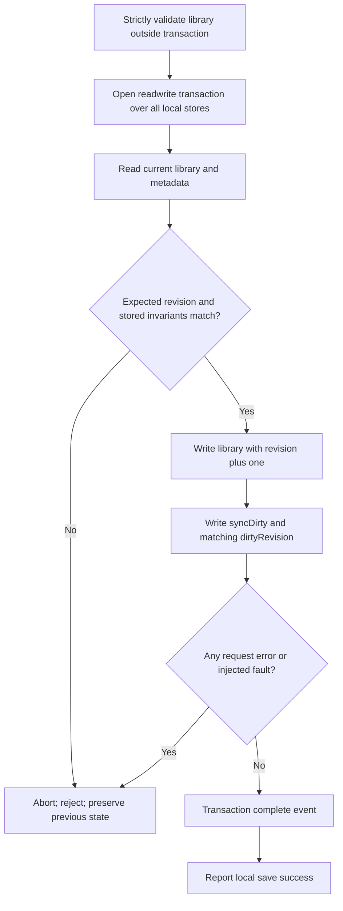
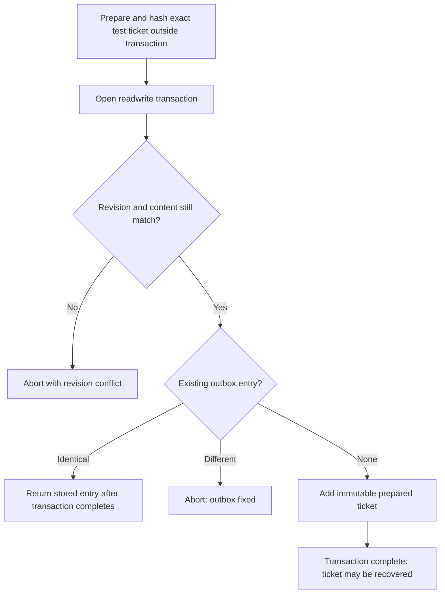

# SYNC-002A: isolated transactional local storage experiment

**Date:** 2026-10-25 (Europe/Vienna). **Status:** Local Chromium experiment passed; production storage integration and migration are NOT approved.

Read with [PoC decision](SYNC-001_POC_DECISION.md), [incremental plan](SYNC-002_IMPLEMENTATION_PLAN.md), [integrity contract](SYNC-002_LOCAL_INTEGRITY_CONTRACT.md) and [DATA-001](../../DATA-001_RUNDOWN_PORTABILITY.md). Those handoff documents and pending unrelated work were not edited.

## Baseline and scope

Work remains on `docs/close-data-001`, HEAD `945c236c846b219b86908beae50cbc893e35048d`. Existing backlog modification, handoff documents and all earlier `tools/sync-poc/` work are preserved. No branch was created, and nothing was committed, pushed, merged or deployed.

Only `tools/local-store-poc/` and this report are new for SYNC-002A. The experiment uses synthetic fixtures on a dedicated temporary localhost origin/profile, never production Rundowns. No Google endpoints, OAuth library, token, network upload, remote write, new dependency, application initialization or service-worker change is introduced. The server allows only its own modules and the existing pure `src/js/templates.mjs` validator, read-only. It does not serve `app.js`, editor UI or an entire repository tree.

## Proposed schema and implemented subset

Database version 1; mandatory test name prefix `easyTimer-SYNC-002A-test-`. Every tested write transaction includes all stores and requests `durability: strict`.

| Store/key | Prototype value | Meaning |
| --- | --- | --- |
| `library/current` | `{libraryId, localRevision, library}` | Validated unchanged schemaVersion 1 payload; monotonically increasing safe-integer revision |
| `metadata/current` | `{syncDirty:true, dirtyRevision, migration}` | Durable work pending; optional legacy source hash and copy-only status |
| `outbox/current` | `{ticket, stage:'prepared'}` | At most one fixed pending publication intent; never overwritten by newer saves |
| `bindings/current` | Absent in this experiment | Reserved store only; no account identity, switching or authorization is implemented |

The handoff's proposed remote `history` cache is not implemented; it belongs to later ancestry/transport work. Bindings are deliberately empty. SchemaVersion 1 Rundown definitions and stable IDs are reused through the existing validator. Strict comparison rejects unknown fields, silently dropped values or normalization changes rather than repairing a legacy library during migration.

A ticket includes `operationId`, synthetic `fileId`, `libraryId`, `localRevision`, parent hashes, exact snapshot bytes and their SHA-256 hash. This is a local intent fixture, not the final SYNC-002B envelope or a real Drive-issued ID. Input is cloned before asynchronous validation. Ticket validation/hashing happens outside transactions; revision, library ID and complete referenced library are checked again inside the ticket transaction. Unexpected fields, including credential fields, are rejected.

There is no upload or acknowledgment/clean operation. Every saved revision stays dirty. New local saves remain available while an older fixed ticket is pending; recovery separately reports the newer dirty revision. An existing ticket is returned only for an identical preparation request; a different replacement is rejected. Recovery reads the stored ticket and never generates a substitute.

## Transactions





No network requests, asynchronous hashing or arbitrary awaited work occurs inside the active IDB transactions. Only IDB request callbacks enqueue follow-up requests. A request success is not treated as commit; promises resolve on transaction completion. Unhandled request errors abort the transaction. On versionchange, the connection closes and refuses further writes; blocked opens report failure rather than pretending to be ready.

The observed same-revision serialization follows the platform's overlapping read-write transaction model. The specification is a reference, not a substitute for the browser experiment. Strict durability was observed as the requested mode in Chromium, but does not prove survival of real power loss or defeat browser eviction. [IndexedDB transaction model](https://w3c.github.io/IndexedDB/#transaction-scheduling).

## Commands and actual results

Run from the repository root:

```powershell
$env:EASYTIMER_BROWSER = 'C:\Program Files\Google\Chrome\Application\chrome.exe'
node tools/local-store-poc/browser-check.mjs
```

Optional manual page, in a fresh browser profile:

```powershell
node tools/local-store-poc/server.mjs
```

Open `http://localhost:8011/` and explicitly run the experiments. Port 8011 is separate from the Google PoC on 8000; no changes to that server or Cloud configuration are needed. The browser runner uses its own dynamic port and temporary profile. It opens an actual second browser tab with its own adapter/IDB connection; this is not two calls to a mocked database. The page refuses to seed legacy data if `easyTimerTemplates` already exists on its test origin. Only a freshly created synthetic fixture is cleaned up afterwards; the adapter never deletes a legacy source or database.

**Observed: 16/16 browser experiments passed in Chromium.** JSON evidence is printed to an OS temporary directory outside the repository. No generated output or browser profile is a production asset.

The existing **73/73 unit regressions** also passed after implementation. Syntax/whitespace checks passed, and `git diff --exit-code -- src tests .github/workflows/deploy.yaml` confirmed no production source, existing test or workflow changes. The full production browser suite was not rerun because no production runtime file changed.

| Experiment | Observed result |
| --- | --- |
| Save plus dirty metadata, stale revision | PASS; matching revision/dirty revision persisted; stale writer rejected |
| Four library-save interruption boundaries | PASS; real transaction abort leaves both stores unchanged |
| Quota fault after queued library write | PASS under injected `QuotaExceededError`; no partial commit |
| Native IDB request error | PASS; actual duplicate-key `ConstraintError` rolls back the whole transaction; strict durability observed |
| Denied storage | PASS under injected SecurityError; no memory-only success fallback |
| Dirty save with no ticket, close/reopen | PASS; dirty revision recovered and `needsTicket:true` |
| Fixed outbox and later local save | PASS; exact old ticket retained; newer dirty revision detected after reopen |
| Ticket prepared before a competing save | PASS; stale ticket rejected inside transaction |
| Three ticket interruption boundaries | PASS; no partial outbox, dirty library preserved |
| Invalid library/ticket | PASS; schema, unknown fields, credential-like field and modified bytes rejected |
| Legacy preview/copy/readback | PASS; preview writes nothing, copied content matches, original source bytes unchanged |
| Invalid/changed source and lost migration acknowledgment | PASS; no cutover; committed copy remains recoverable with unverified migration marker |
| Legacy writer during copy | PASS; post-copy source change detected; result explicitly non-authoritative |
| Two real tabs saving same revision | PASS; exactly one commits, the other gets `REVISION_CONFLICT`; resulting dirty revision is coherent |
| Blocked IDB upgrade | PASS; actual blocked event reports `OPEN_BLOCKED` |
| Version change and closed adapter | PASS; connection closes and later write fails |

Fault injection uses actual IndexedDB transactions and aborts. Injected quota/security failures are NOT native quota exhaustion or OS policy verification. Close/reopen and aborts are NOT a browser-process kill or power-loss test. Safari, Firefox, private browsing, physical iOS/PWA, eviction and true disk-full behavior remain untested. The prototype intentionally fails when strict transactions/opening are unsupported; it does not silently downgrade to localStorage.

## Dry-run migration and safe future transition

Implemented copy experiment:

1. Explicitly read the caller-supplied synthetic legacy source. Do not access legacy storage at adapter startup.
2. Parse, fully validate and compare content; reject malformed JSON, unknown schema/fields, duplicate IDs, unsupported values and changes that normalization would conceal.
3. Return preview plus source hash; do not write anything.
4. On explicit copy, recheck exact source bytes. Copy only into an empty test destination, with library revision and dirty metadata in one transaction. Refuse an existing destination.
5. Read the copied destination back and compare the complete content. Re-read the source afterwards. If it changed, report `source-changed-no-cutover`; both copies remain for review.
6. Retain the original source. The persisted migration marker remains copy-only/unverified, including after an acknowledgment failure. No active storage backend is switched.

There is no transaction spanning localStorage and IndexedDB. The before/after source checks detect tested changes, but cannot prevent another legacy write immediately afterwards. Consequently this experiment NEVER claims that automatic cutover is safe.

Before any future production migration, obtain separate approval and:

1. Require an independent DATA-001 export and record the exact starting origin/profile. Changing domain does not migrate browser storage.
2. Resolve open drafts and ensure **all** tabs/windows/PWA instances that can write legacy storage are closed or upgraded. A new-tab localStorage flag cannot enforce this against old code that ignores it. If old writers cannot be excluded, stop the cutover and retain both versions.
3. Run an explicit validated copy/readback on the same origin, preserving the original source. Reconcile any differing destination/source rather than replacing one.
4. Adopt a versioned backend-selection state only after a reviewed recovery/cutover design. Interrupted selection must reopen into a diagnostic state, not start competing old/new writers or choose the older copy automatically.
5. Route every production read/write, including JSON import and deletion, through the same transactional adapter before enabling it. Do not dual-write and assume atomicity.
6. Validate real Firefox, Safari, installed iOS PWA, private/blocked storage, quota, eviction and process-interruption behavior. PWA upgrade/version lifecycle needs separate testing; this spike does not modify it.

**Rollback now:** Stop the isolated server and stop using the prefixed test database. The production code and storage path never changed. Existing synthetic databases can be retained for inspection; no automatic deletion is performed.

**Rollback after a future migration:** Freeze all writers first. Do not simply reactivate the retained legacy copy: it becomes stale after the first new-backend edit. Export/read the latest validated IDB library plus preserve dirty/outbox records, reconcile divergence explicitly, then restore through an approved path. If IDB is unavailable, use the independent backup and explicitly identify any unrecoverable changes. Neither backend can guarantee survival after the user clears all browser data.

## Integrity-contract coverage

PASS below is evidence only for the local scope and tested Chromium environment. DEFERRED is not claimed as implemented.

| Contract invariant | Coverage / result |
| --- | --- |
| Validated Rundown definitions, stable IDs; no timer/draft data | PASS: existing validator reused; strict full-content checks; no production initialization |
| Library/localRevision/syncDirty candidate | PASS: library and matching dirty revision commit together |
| Bindings/account association and confirmed ancestors | DEFERRED to account/transport work; binding store empty |
| Immutable outbox bytes/hash/revision/stage | PASS for synthetic prepared ticket; no upload stage transitions |
| Remote history cache | DEFERRED to SYNC-002B/C |
| All-or-nothing save and dirty marker | PASS: abort points and native request-error rollback |
| Report success only after durable local transaction | PASS at IDB complete boundary; physical-media durability not established |
| Crash after save, before ticket | PASS for close/reopen recovery; real process-kill still required |
| Durable complete ticket before upload | PASS for local ticket transaction; no upload code exists |
| Hash/network outside transactions | PASS: hash outside; no network functionality |
| Revision rechecked inside ticket transaction | PASS: competing-save test |
| Every tab uses same transactional adapter | PASS for two test tabs; excluding old production writers remains a rollout blocker |
| Do not clear/replace legacy source | PASS for dry-run copy; no automatic migration |
| Full migration validation/readback | PASS, including changed source and post-commit lost acknowledgment |
| localStorage/IDB non-atomic boundary | Explicit limitation; no cutover attempted |
| Old SW tabs/windows, cross-origin and PWA upgrade | DEFERRED real rollout/device gate; no SW changes |
| iOS/private browsing/blocked/quota/eviction | Blocked open tested; denial/quota injected; physical-device/private/eviction NOT TESTED |
| DATA-001 remains independent | Production portability untouched; existing regression tests run separately |
| No upload until save/ticket durable | Enforced structurally by absence of network; real transport integration DEFERRED |
| Retry/restart never replaces operation/file IDs | PASS for retained local ticket and replacement rejection; no Google calls |
| Full remote readback after 2xx/409/unknown outcome | DEFERRED to SYNC-002C |
| Graph reread before reconciled claim | DEFERRED to SYNC-002B/C; no such status emitted |
| Missing/partial listing not deletion; no pruning | No remote listing/deletion/pruning implemented; DEFERRED |
| Stable IDs/common parent, not names, establish identity | IDs preserved locally; ancestry DEFERRED to B |
| One-sided edit or independent edits: safe merge candidate | DEFERRED to B; revision conflict never silently merged here |
| Same ID changed on both sides | Local revision race rejected; semantic cross-device conflict DEFERRED |
| Delete versus edit/tombstones | DEFERRED to B; no inferred deletion or new deletion policy |
| Keep both: fresh Rundown/phase IDs | DEFERRED; DATA-001 import semantics unchanged |
| Real semantic merge, not only multi-parent labels | DEFERRED; no merge implementation |
| Parents are reviewed heads; late head unresolved | DEFERRED to B; previous Google observations are not local-storage evidence |
| Multiple roots, contradictory hashes, malformed/unknown/cyclic/missing history | Invalid local schema/bytes rejected; graph/history checks DEFERRED |
| Local only | Local prototype requires no Google; production status UI unchanged |
| Changes pending | Dirty revision persists; no false clean transition |
| Upload verified / last checked and reconciled | Not implemented or emitted |
| Conflict | Explicit REVISION_CONFLICT / OUTBOX_FIXED; production wording/UI DEFERRED |
| Reconnect | Not implemented; no credentials or authorization |
| Sync error retains data/ticket | Local injected errors preserve previous transaction state; remote errors DEFERRED |
| Simultaneous multi-tab saves | PASS with actual second tab and independent connection |
| Crash at save/ticket/upload/readback/discovery/account switch | Save/ticket abort and reopen tested; physical crash and network/account phases DEFERRED |
| HTTP errors, CORS, timeouts, duplicate create | Outside local scope; no external requests performed |
| Quota/eviction/malformed JSON | Quota injected and malformed JSON rejected; eviction NOT TESTED |
| Late branch/first sync/delete-edit/rename/reorder/keep-both | Snapshot/semantic work DEFERRED; existing schemas and IDs unchanged |
| Timer unaffected | Production `src/` unchanged; no timer modules loaded by experiment |
| Production release requires broader passing evidence | NOT satisfied; production migration/sync remains NO-GO |

## Recommendation and next bounded step

IndexedDB is a suitable **candidate** for atomic local revision plus dirty-state persistence based on these observed tests. This does not establish production migration, physical durability, account isolation or iOS support.

Recommend accepting this local experiment only. The next small development increment is **SYNC-002B**, beginning with a separately approved pure envelope/canonicalization and ancestry specification plus deterministic tests, no Google/UI/production storage path. Before production adapter adoption, schedule independent real-device and process-interruption gates and resolve old-writer exclusion/cutover; do not treat B approval as approval to migrate storage.

Recommended coding model/effort: **GPT-6.1 Sol / Medium** for the next bounded implementation; increase review depth for Unicode canonicalization and migration/account boundary decisions. No model change was performed by this task.

New files: `adapter.mjs`, `experiments.mjs`, `browser-check.mjs`, `server.mjs`, `ui.mjs`, `index.html` under `tools/local-store-poc/`, plus this report. No other files changed for SYNC-002A.

## Exact final Git status

No staged files. HEAD unchanged at `945c236c846b219b86908beae50cbc893e35048d`. `tools/` includes both the pre-existing isolated Google PoC and the new local-storage experiment; the former was not edited in this increment.

```text
## docs/close-data-001
 M docs/backlog.md
?? docs/INFO-001_PUBLIC_PAGES_BRIEF.md
?? docs/README_HANDOFF.md
?? docs/SYNC-001_IMMUTABLE_SNAPSHOT_POC.md
?? docs/SYNC-001_ISOLATED_POC.md
?? docs/SYNC-001_POC_DECISION.md
?? docs/SYNC-002A_AGENT_PROMPT.md
?? docs/SYNC-002A_LOCAL_STORAGE_EXPERIMENT.md
?? docs/SYNC-002_IMPLEMENTATION_PLAN.md
?? docs/SYNC-002_LOCAL_INTEGRITY_CONTRACT.md
?? tools/
```
