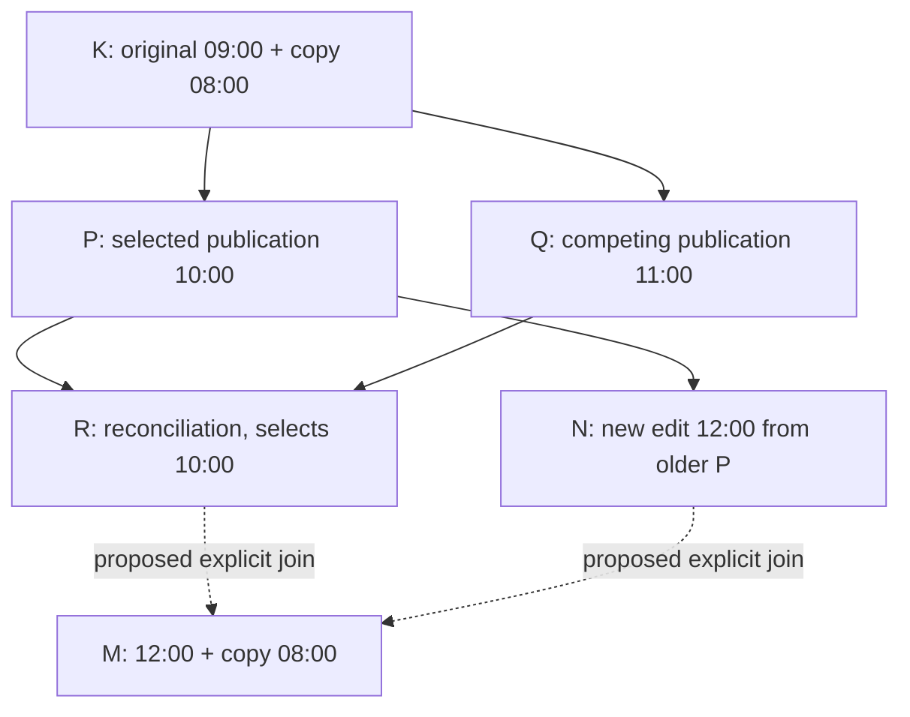

# SYNC-003B — Concrete two-head / no-content-conflict diagnosis

**Current status - historical report:** SYNC-003B is functionally accepted in local development. Owner-operated real Google Drive acceptance passed for A/B/Keep Both, explicit conflict-free reconciliation, live recovery and preservation of the second client's unpublished changes. Both Firefox contexts ended with the same 13:00 + 08:00 library and Synced (last checked). Final local diagnostics showed one valid head, matching base, no dirty changes and no pending tickets; they do not independently verify current remote Drive state. Production remains NO-GO. See [completed acceptance and production blockers](../implementation/SYNC-003B_CONFLICT_RESOLUTION.md#completed-owner-acceptance--local-development-only) and the [implemented correction](../implementation/SYNC-003B_CONFLICT_FREE_RECONCILIATION.md).

The original investigation below is preserved as historical evidence. Pending reports, unsupported review and unperformed recovery describe that earlier stage, not current development status. Successful recovery does not establish the missing historical parent chain.

**Verdict:** the live metadata confirms the immediate blocking cause: a validated two-head history with one common base and a semantically conflict-free `proposed` result is rejected by the current conflict-only review gate. A focused native-IndexedDB/application reproducer now produces the reported state pattern. The exact historical parent IDs and origin of the owner's new head remain unproven because the supplied reports do not include those parent lists or the last-publication receipt. No runtime fix, automatic reconciliation, live storage access or Google call was performed.

**Subsequent approved correction:** [verified conflict-free reconciliation](../implementation/SYNC-003B_CONFLICT_FREE_RECONCILIATION.md) is now implemented locally with explicit preview/confirmation and unchanged publication safeguards. This report records the diagnosis before that correction; no owner's live state has been recovered and the exact historical parent-chain uncertainty remains.

## Supplied facts and safe deductions

Use these aliases only for explanation:

- **N:** `sha256:98871478e5e0d72bf515c80e2ca6f56c3ba63524368dd26ef86ff7d3e98f53e1` — A's current base, one of its two known heads.
- **R:** `sha256:8eb29b57721d7d673f497c0f1ff3ff8d5a46cea46f59d1e00f9da9fa77f9086d` — B's current base and sole locally known head, also a head in A's validated graph.

A: revision 8, dirty false, nine cached snapshots, two heads N/R, unique common base, `proposed` / `NO_CONTENT_CONFLICT`, no outbox/intent/review. B: revision 7, dirty true, eight cached snapshots, locally known head/base R, no outbox/intent/review. The owner reports local original 12:00 on A and 13:00 on B, with the independent 08:00 copy retained; 13:00 has not been published.

**Confirmed:** N is not a descendant of R, and R is not a descendant of N in A's complete validated cache. An ancestor cannot remain a head when its descendant is present. In particular, an ordinary N snapshot with `parents: [R]` cannot yield this pair. Both heads nevertheless have a unique validated common ancestor and no unresolved per-Rundown content decision under the current core.

**Not confirmed from these fields alone:** N's direct parent, the common base hash, R's full parent chain, whether N was newly created by A versus previously recovered/discovered, or which base A held immediately before its attempted sync. Counts 9 versus 8 are consistent with an additional observed snapshot but do not prove complete equality of the two cached node sets. A's current base is post-operation state, not a record of the previous base.

If R was the actual common verified starting head for A's third-round edit, the observed pair is incompatible with an ordinary child of that head. Identical displayed 10:00/08:00 content and two last-checked labels do **not** prove both controllers had acknowledged the same R hash at the same time. One client may already contain the selected content under its earlier publication head and still show a successful older observation. This difference is central to the reproduced mechanism; it is not proof that the owner skipped any action.

## Publication-path audit

- `tools/app-sync/controller.mjs:133` discovers history and calls `observe`. Clean local data may fast-forward to a unique descendant. Dirty data does not take that clean-install path.
- `controller.mjs:156` deliberately permits the separately guarded sibling-publication path when there is one remote head, dirty local data and a known local base. The remote head must descend from that base. It does **not** silently rebase the edited library onto the latest remote head.
- `controller.mjs:161` / `:165` chooses `bindings.base` as the ordinary snapshot parent, not the latest listing's head. `tools/app-sync/storage.mjs:76`–`:85` validates `prepareBranch`: unchanged source revision/content, account, base, observed head set, known ancestry and no existing ticket. The ordinary `prepare` invariant remains stricter; the branch path is intentional and immutable.
- `controller.mjs:139`–`:144` recovers any existing fixed ordinary ticket before new work. Such a ticket retains its original parents across retries. The current absence of an outbox does not prove there was never an older pending ticket.
- `storage.mjs:133`–`:136` finalizes a verified ordinary ticket after exact readback and discovery: it assigns that snapshot as the new local base, clears dirty for the matching local revision and retires the ticket **even when another remote head remains**. This acknowledges publication, not global convergence.
- `storage.mjs:139` still marks multiple graph heads as conflict. The post-publication check at `controller.mjs:174` then throws `reviewRequired`. Thus A's stop can happen **after** publishing and acknowledging its own 12:00 snapshot; an absent outbox plus dirty false is consistent with that path. It is not evidence of an upload still waiting to be retried.
- A successful local resolution install (`storage.mjs:125`) and clean peer adoption (`storage.mjs:142` onward) update library and base transactionally. The existing four consecutive-round tests explicitly verify those fields before third-round editing and continue to pass. No unconditional stale-parent bug was found when A actually holds the verified R base and no other actor changes it.

Reconnect binds the same account but does not choose a new snapshot parent. It can expose the condition on the next sync but is not required to produce it.

## Focused reproducer — PASS

The new application scenario starts with a synthetic 09:00 original and independent 08:00 copy, representing the already completed Keep Both baseline. It targets the second/third-round transition rather than inventing extra live snapshots to force counts to 8/9:

1. A and B share that baseline K; A saves/publishes 10:00 as P, while B independently saves/publishes 11:00 as Q.
2. B resolves P/Q by explicitly selecting A's 10:00 content, producing R. B installs R. **A does not pull R before its next edit** in this controlled variant.
3. Both libraries now display the same 10:00 original and 08:00 copy. Both local status getters say last-checked, but A's base is P and B's base is R. Content equality does not imply base equality.
4. A saves 12:00, B saves 13:00, and A explicitly authorizes the same mock account again. B does not publish 13:00.
5. A discovers R, then intentionally publishes N with parent P through `prepareBranch`. R remains a head. A verifies N, clears dirty/retires the ticket, assigns base N and then reports conflict.
6. A's diagnostic shows two heads, one common base, `proposed`, `NO_CONTENT_CONFLICT`, dirty false and no ordinary/reconciliation ticket. B still has one locally cached head R, dirty true, and its 13:00 edit. A's snapshot count is exactly one greater than B's.
7. A's Review conflict fails `unsupportedConflict`. An in-memory core-only join with **zero decisions** validates as a sole head, preserving 12:00 and the unchanged 08:00 copy. It is not uploaded or installed by the test as a runtime feature.

This is the exact **state pattern**, not a claim to have reconstructed the owner's unknown parents. The earlier full three-round tests still cover the contrasting case where both clients really adopt R before the next edit; that case publishes A's first subsequent edit successfully.

Compatible synthetic parent chain (not a verified mapping of the owner's missing parent lists):



Here P is the unique common base of R and N. R's selected Rundown is unchanged relative to P; only N changes it to 12:00. The independent copy is unchanged on both branches. B's 13:00 has no remote node and cannot cause A's current two-head state.

Two fixed-identity Node tests independently prove: (1) this stale-selected-parent topology is valid, yields `proposed` and permits a semantically correct zero-decision join; (2) changing N's parent to R produces one head, ruling out `parents: [R]` as an explanation of the supplied pair.

## Why review reports NO_CONTENT_CONFLICT

`tools/sync-core/reconcile.mjs:57`–`:59` accepts equal branch states or a branch unchanged from the common base without requiring A/B selection. This preserves independent changes by Rundown identity; it is not field-level merging. `tools/sync-core/graph.mjs:93` returns `proposed` when there are no unresolved rows and no order-policy blocker.

`tools/app-sync/controller.mjs:73` requires `analysis.status === 'conflict'`, so it rejects this valid proposed state before any UI preview. This is the **confirmed current functional limitation**. `NO_CONTENT_CONFLICT` does not mean the heads must have identical contents; it means their differences require no competing whole-Rundown choice under the validated common-base rules.

The two supplied heads alone do not prove the live branch contents are otherwise exactly the synthetic example. They do prove that the current cached core analysis has no unresolved content decisions. Full merged-library preview and validation must still precede any real recovery.

## B's HEAD_COUNT_NOT_TWO

B's report is local-only: its eight-node cache knows R as the sole head and retains a dirty 13:00 edit. The diagnostic does not list Drive or publish anything. Its `HEAD_COUNT_NOT_TWO` says only that this cached observation is not a two-head review input. It does not contradict A's newer two-head observation and is not evidence that Drive still has one head.

## Classification and smallest safe correction proposal

No hash/protocol integrity defect or silent overwrite is demonstrated. A conservative immutable branch from a known older base is an expected supported publication operation; the unexpected user-visible dead end is the **currently unsupported conflict-free divergence**. The selected-content/stale-base mechanism is reproduced. Whether that was the owner's exact sequence remains conditional on the missing parent/receipt metadata.

Smallest bounded proposal, requiring owner approval:

- Extend review to accept a validated `proposed` result for **exactly two heads and one unique validated common ancestor**, with no order-policy blocker and no existing pending ticket/newer unpublished local work.
- Show a localized message that the histories differ without competing Rundown choices, plus the complete readonly result preview. Do not invent A/B radio choices when there are zero conflicts. Require explicit owner confirmation; no automatic reconciliation.
- Reuse `createReconciliation(..., choices: {})` and the existing fixed ticket, durable sidecar, recheck-before-publication, exact readback, complete-discovery and guarded atomic-install flow. The resulting immutable snapshot records both parents and zero content decisions. Do not rewrite either existing head or falsify a one-parent acknowledgement.
- Preserve all current account/revision/ancestry/outbox safeguards. More than two heads, unsupported order changes, invalid history and conflicting choices stay blocked. Do not change ordinary publication parent selection as a speculative shortcut. A future optimization may avoid a branch when remote/base content is provably unchanged, but that is not needed to remove this dead end and would not consume the two existing live heads.

The core already supports this explicit semantic join, demonstrated only with disposable/in-memory data. No wire-format change, default winner, identity regeneration or cleanup is necessary for the conflict-free case.

## Recovery implications

No metadata indicates a need to clear storage. A's 12:00 and both original heads can be preserved by an explicitly reviewed join. B's pending 13:00 **must not be overwritten** by adopting A's result. After an approved join is safely installed on A, B's retained edit may publish from its old R base and create the genuine 12:00/13:00 conflict, which then requires the ordinary explicit A/B/Keep Both decision. This sequence is a proposed recovery plan, not an action already authorized or performed.

The current UI cannot perform the conflict-free join. Do not bypass it with direct calls, drop one head, edit `base`, clear dirty/outbox, overwrite a library or import a backup over either context. First obtain implementation/recovery approval and inspect the actual merged preview. Fresh remote discovery at that future moment may reveal a changed head set; if so, invalidate the proposed recovery.

To establish the exact historical cause without retrieving Rundown contents, the missing evidence is: N's parent list, R's parent list, their unique common-base hash, and A's last-publication snapshot/parents (or proof that N came from adoption rather than publication). A readonly cache/receipt diagnostic could supply those under separate scope. Their absence does not prevent identifying the current blocking gate, but it prevents claiming the exact live stale-parent chain is proven.

## Changes and actual tests

Only this increment's test/documentation changes:

- `tools/app-sync/conflict-experiments.mjs`: one focused stale-selected-base / proposed-two-head scenario.
- `tools/app-sync/browser-check.mjs`: expected scenario count from 21 to 22.
- New `tools/app-sync/proposed-heads.test.mjs`: two deterministic, fixed-identity pure topology/control tests.
- This report and a follow-up link/status clarification in the preceding diagnosis report.

**148/148 Node tests PASS**, including the two new topology tests and existing snapshot, diagnostics, transport, Quick/Planner/Session/DATA-001 suites. Application browser harness: **22/22 conflict scenarios, 14/14 application integration scenarios, 4/4 readonly diagnostics scenarios PASS**, plus actual two-context UI, no-default selection, themes/languages/mobile, preview, reload and GET-only recovery checks. `git diff --check` passes. No current test failure is introduced: the reproducer asserts the existing unsupported stop rather than pretending the unimplemented recovery works. The full separate production-browser suite was not rerun for these test/documentation-only additions; its prior results remain historical.

Inspected runtime references: `tools/app-sync/controller.mjs`, `storage.mjs`; shared `tools/sync-core/graph.mjs`, `reconcile.mjs`; existing application experiments/harness. Their synchronization logic was not modified. No owner browser, Google API, server restart, OAuth setting, migration, cleanup or automatic join was used.

Branch: `feature/sync-003b-conflict-resolution`. HEAD: `d67658da46e55bb83117e9c553bb5dd5cafba042`. Nothing staged; all previous B/diagnostics work preserved. No commit, tag, push, merge or deployment. Exact pending paths are recorded in the final handoff; runtime paths already marked modified predate this diagnosis.

```text
## feature/sync-003b-conflict-resolution
 M docs/BRIEFING.md
 M docs/SYNC-002B_SNAPSHOT_CORE.md
 M docs/backlog.md
 M tools/app-sync/browser-check.mjs
 M tools/app-sync/controller.mjs
 M tools/app-sync/drive.mjs
 M tools/app-sync/gate.test.mjs
 M tools/app-sync/panel.mjs
 M tools/app-sync/server.mjs
 M tools/app-sync/storage.mjs
 M tools/sync-core/canonical.mjs
 M tools/sync-core/graph.mjs
 M tools/sync-core/reconcile.mjs
?? docs/SYNC-003B_CONFLICT_RESOLUTION.md
?? docs/SYNC-003B_CONSECUTIVE_CONFLICT_DIAGNOSIS.md
?? docs/SYNC-003B_READ_ONLY_DIAGNOSTICS.md
?? docs/SYNC-003B_TWO_HEAD_ANALYSIS.md
?? tools/app-sync/conflict-experiments.mjs
?? tools/app-sync/conflict-panel.mjs
?? tools/app-sync/diagnostic-experiments.mjs
?? tools/app-sync/diagnostics.mjs
?? tools/app-sync/diagnostics.test.mjs
?? tools/app-sync/proposed-heads.test.mjs
?? tools/sync-core/copy-names.test.mjs
```
